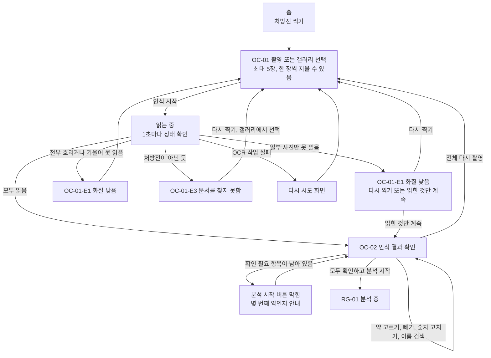
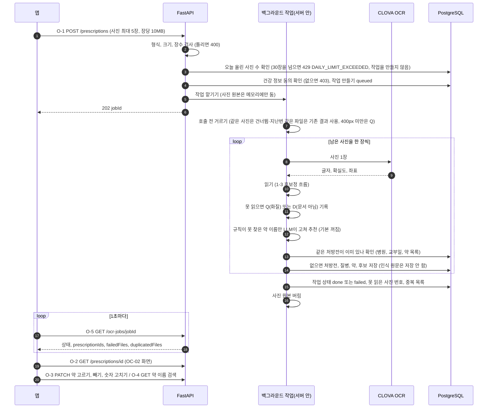
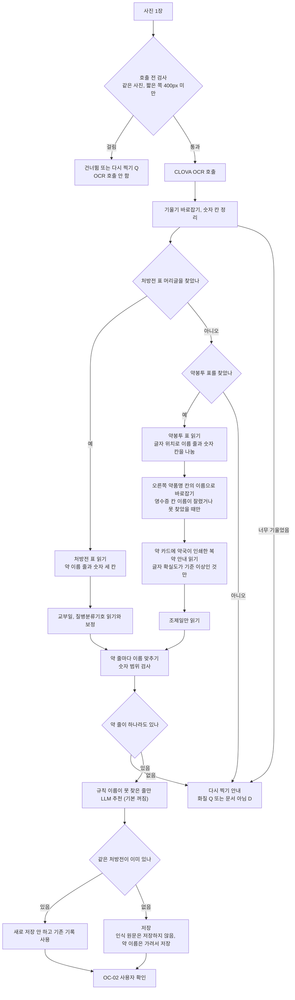
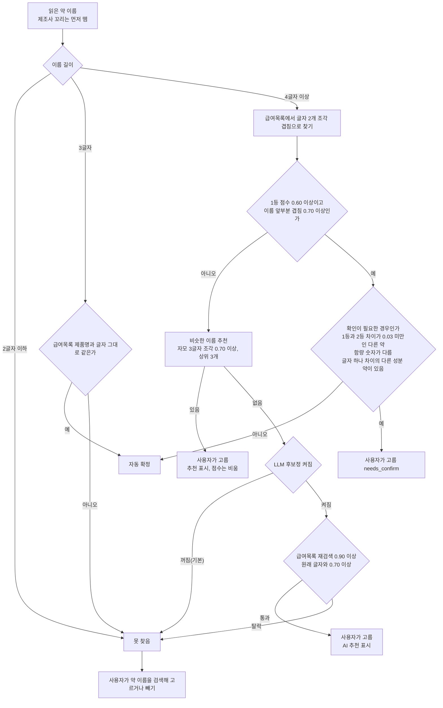
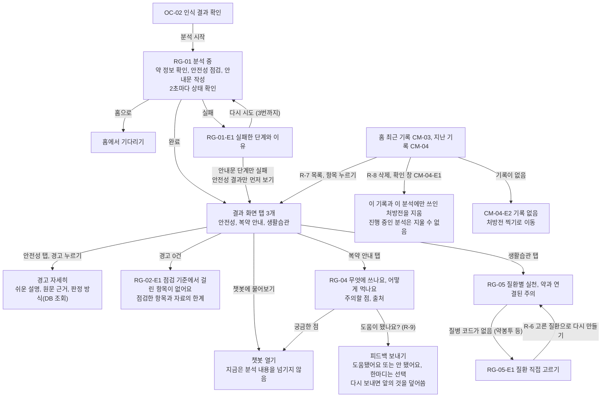
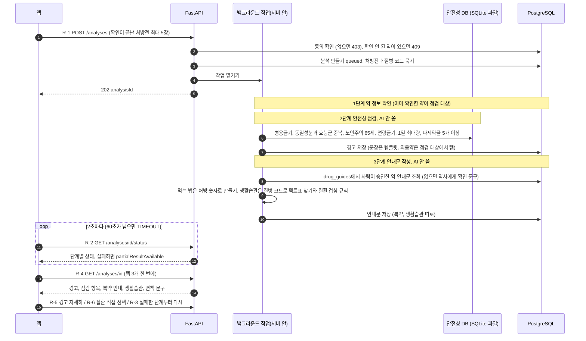
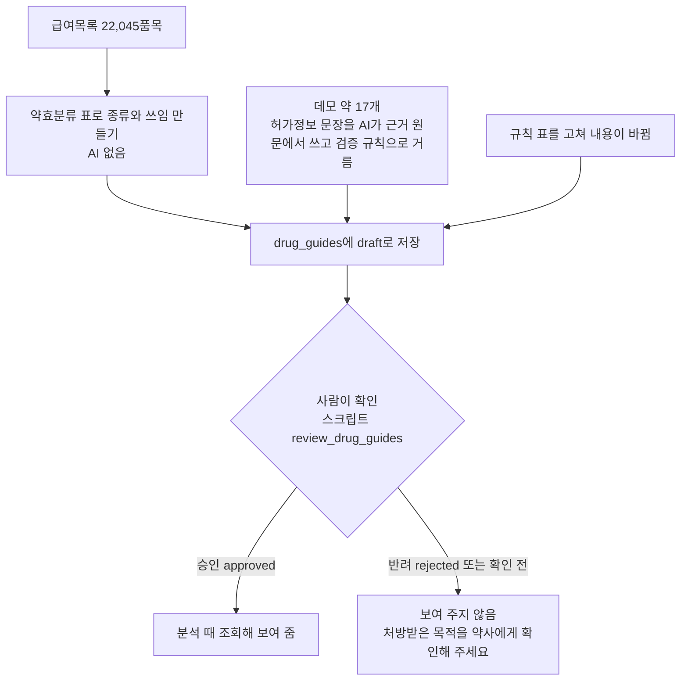
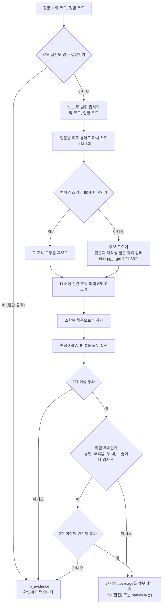

# 흐름도 OCR와 RAG (10/19)

> 작성: 김채연 (Claude 초안, 사람 검토 전)
> 기준 코드: main 7f00bdd (PR #97 병합, 10/16)에 10/19 작업(지난 기록, 삭제, 피드백, 하루 사진 상한, 근거 검색 서버)를 더한 작업 브랜치. 10/2 흐름도(`플로우차트_OCR_RAG_1002`)를 코드와 대조해 고쳤어요.
> 노션에 붙일 때 코드 블록 언어를 Mermaid로 고르면 그림으로 보여요. 화면 번호는 화면 번호표, API 번호는 API 명세서 v1.5 초안 기준이에요.

---

## 0. 10/2 흐름도에서 바뀐 것

| 항목 | 10/2 흐름도 | 지금 코드 | 확인한 파일 |
|---|---|---|---|
| 오래 걸리는 일 | Redis와 arq 워커 | OCR은 `OCR_WORKER=true`이면 arq 워커(사진은 S3에서 읽음, `ocr_worker.md`), 아니면 FastAPI 백그라운드 작업(서버 안). 분석은 아직 서버 안. 서버가 다시 시작되면 끊겨서, 조회할 때 15분이 지난 OCR 작업은 실패로 닫음 | `prescriptions.py`, `analyses.py` |
| OCR 호출 전 | 없음 | 같은 사진(이번 업로드 안, 같은 사용자의 지난 업로드는 prescription_file_hashes로), 짧은 쪽 400px 미만을 거름 | `precheck.py` |
| 읽는 대상 | 처방전 표 | 처방전 표, 약봉투 표(머리글 없는 목록 포함), 약봉투 약 카드의 복약 안내 문구 | `pipeline.py`, `pouch.py`, `pouch_guide.py`, `pouch_panel.py` |
| 약 이름 맞추기 | 표기 통일과 글자 조각, 후보 3개 | 규칙, 형제 약 확인, 비슷한 이름 추천, LLM(기본 꺼짐) | `matcher.py`, `llm_fix.py` |
| 같은 처방전 | 없음 | 병원, 교부일, 약 목록이 같으면 새로 저장하지 않고 기존 기록을 씀 | `prescriptions.py` |
| 인식 원문 | 정하지 않음 | 저장하지 않음. 약 이름은 가린 뒤 저장 | `ocr_mask.md` |
| 안내문 | gpt-4o-mini가 근거 사실로 쉬운 말을 씀 | 미리 저장해 둔 안내문 중 사람이 승인한 것만 조회. 분석 때 AI를 부르지 않음 | `guide/store.py` |
| 생활습관 | 질병 코드로 팩트표 | 같음. 질환을 직접 고르면 다시 만듦(R-6) | `guide/lifestyle.py` |
| 벡터 검색 | 거의 안 씀 | 분석에는 쓰지 않음. 챗봇 근거 검색용으로 서버 코드를 만듦(3장, pgvector) | `embedding.md`, `app/services/rag/` |
| 사진 수 상한 | 없음 | 사용자별 하루 30장을 넘으면 429로 막음(1-2) | `prescriptions.py` |

지금 코드와 문서가 어긋나는 곳: `SYSTEM_DESIGN.md`, `README.md`, `AGENTS.md`는 "Redis와 arq 워커"가 목표로 적혀 있고, 코드는 OCR과 분석 모두 FastAPI 백그라운드 작업이에요. 10/19에 `SYSTEM_DESIGN.md`와 `README.md`에는 "지금은 백그라운드 작업"이라는 현재 상태를 적어 뒀고(`AGENTS.md`는 그대로), 어느 쪽으로 맞출지는 멘토링에서 정해요(4장).

---

# 1. 피처 1 OCR

## 1-1. 화면 흐름 (사용자가 보는 것)

화면에서 알아 둘 것: 같은 처방전을 다시 올리면 오류 없이 "이미 올린 처방전" 안내가 나오고 기존 기록을 써요(`duplicatedFiles`). 약봉투처럼 머리글이 없거나 글자가 흐리게 읽힌 약은 자동으로 정하지 않고 사용자가 줄마다 확인해요.

## 1-2. 서버 처리 흐름

- 작업 실패(`failed`)는 사진 전부가 CLOVA 호출 실패(F)이거나 처리 중 예외가 났을 때예요. 일부 사진만 못 읽으면 `done`으로 끝나고 못 읽은 사진 번호를 알려 줘요.
- 같은 사진(바이트 동일)은 두 번째부터 호출하지 않아요. 같은 처방전(읽은 내용 동일)은 읽은 뒤에 걸러요.

## 1-3. 후보정 흐름 (10/13 초안을 코드에 맞춘 것)

## 1-4. 약 이름 하나가 처리되는 길

- 약봉투 약 이름은 영수증 칸(글자가 작고 10자쯤에서 잘림)과 오른쪽 "약품명" 칸(크고 확실함)에 두 번 적혀 있어요. 영수증 칸 이름이 믿기 어려울 때만 약품명 칸의 이름으로 바꾸고, 함량 숫자가 같고 두 번째 후보보다 확실히 비슷할 때만 바꿔요. 바꾸면 화면에 "약품명 칸의 이름으로 바로잡았어요" 표시가 붙어요.
- 약 카드에 약국이 인쇄한 복약 안내("식사와 함께 복용하세요" 같은 문장과 "쪼개지 마세요" 같은 표시)는 글자 확실도가 기준(평균 0.8, 가장 낮은 낱말 0.6) 이상일 때만 남기고, 가린 뒤 약 줄마다 저장해요. OC-02에 "약봉투에 적힌 안내, 사진에서 읽은 글자예요. 틀릴 수 있어요"로 보여 줘요. 이 값은 샘플 약봉투 몇 종으로 정한 것이라 근거가 많지 않아요.
- 이름이 잘렸거나(`...`로 끝남), 이름 글자 확실도가 0.5 미만이거나, 숫자 줄이 어느 약 것인지 불확실하거나, 약봉투에 머리글이 없으면 찾았어도 자동 확정하지 않고 사용자가 고르게 해요.
- 자동 확정이 틀릴 위험은 형제 약 확인으로 줄였어요. 약 이름 14,859개 중 1,329개(8.9%)가 성분이 다른 한 글자 차이 형제를 가져요.

## 1-5. 설명할 때 포인트

1. 왜 비동기인가: 사진마다 CLOVA를 한 번씩 부르므로 요청을 붙잡고 기다리지 않고 202로 먼저 답한 뒤 서버가 뒤에서 처리해요. 지금은 서버 안 백그라운드 작업이라 서버가 다시 시작되면 끊겨요(0장 표).
2. 약은 누가 정하나: 이름 맞추기는 DB 조회와 규칙으로만 해요. 애매하거나 흐린 것은 사용자가 OC-02에서 고르고, 확인이 안 끝나면 분석이 시작되지 않아요(R-1이 409로 막음).
3. 후보정이 왜 규칙 먼저인가: 처방전 글자는 AI가 지어내면 안 돼요. 오타 1,000건 중 규칙과 비슷한 이름 추천이 83%를 후보에 올렸고, LLM이 더한 것은 4건과 6건(0.4%p와 0.6%p)이었고 틀린 약 추천은 0건이었어요. 그래서 LLM은 기본 꺼 뒀어요. 켜면 약 이름이 외부로 나가요.
4. 호출 전 거르기: 같은 사진, 짧은 쪽 400px 미만, 너무 흐린 사진은 호출 비용을 아끼려고 거르고, 처방전이 아닌 사진을 호출 전에 거르는 방법은 시험했지만 쓰지 않았어요. 8도만 기울여도 처방전 7장 중 6장을 잘못 걸러서예요. 비처방전은 호출 1회를 쓴 뒤 안내해요.
5. 사진과 원문: 사진 원본은 저장하지 않고 인식이 끝나면 버려요. 인식 원문도 저장하지 않아요.
   - 10/22 결정(구현 10/26): 사진은 S3 버킷에 저장하고(10/23 S3 사용 확인으로 서버 디스크에서 바꿈, 코드는 서버 디스크도 지원) 24시간 뒤 자동 삭제해요(성공 · 실패 모두). 저장 코드는 설정값 `PHOTO_STORAGE`를 비워 두면 꺼져 있어서, 서버에서 켜기 전까지는 위 설명(저장하지 않음)이 지금 동작이에요. OCR 호출 전에는 파일 해시(SHA-256)로 같은 파일을 거르고(같은 사용자 안에서만), 너무 흐린 사진을 호출 전에 거르는 검사는 뺐어요(98장 실험 결과는 `ocr_precheck.md`). 해시 검사와 흐림 검사 제거는 코드에 반영됐어요(10/26 패치).
6. 여러 쪽 PDF: CLOVA가 쪽마다 한 칸씩 돌려주는 것을 10/19에 실제 2쪽 PDF로 확인했어요. 쪽마다 처방전 하나로 읽고, 한 쪽이 실패해도(첫 쪽이어도) 읽힌 쪽은 저장하고 모든 쪽이 실패했을 때만 그 파일을 실패로 알려요. 10칸 중 일부 실패는 가짜 응답으로 시험했어요.

---

# 2. 피처 2 RAG 분석

## 2-1. 화면 흐름 (사용자가 보는 것)

## 2-2. 서버 처리 흐름

- 단계가 실패하면 그 단계에서 멈추고 `failed_step`에 적어요. R-3 다시 시도는 그 단계부터 이어서 해요(3번까지).
- 안내문 단계만 실패하면 경고는 먼저 볼 수 있어요(`partialResultAvailable`).

## 2-3. 안내문이 미리 만들어지는 길 (배치, 분석과 따로)

## 2-4. 설명할 때 포인트

1. AI를 쓰는 곳과 안 쓰는 곳: 분석 중에는 AI를 한 번도 부르지 않아요. 안전성 점검은 심평원 DUR 조회로만 판정하고(NFR-032), 안내문은 미리 만들어 사람이 확인한 것만 보여 줘요. AI는 데모 약 17개의 허가정보 문장을 미리 쓸 때만 썼고, 그 문장도 원문 안의 내용인지 규칙으로 걸렀어요.
2. 사람 확인: 안내문은 사람이 승인해야 화면에 나가요. 사람이 보는 것은 "문장이 근거 원문과 어긋나지 않는가"까지이고 약사나 의료진 검수는 아니에요.
3. 단계를 나눈 이유: 안내문 단계만 실패해도 안전성 경고는 먼저 보여 줄 수 있어요.
4. 같은 처방이면 같은 답: 분석 중 AI를 쓰지 않아서 같은 입력이면 같은 결과가 나와요.
5. 한계: 주의할 점 문장이 채워진 약은 데모 약 17개뿐이고, 나머지는 약효분류 표의 쓰임만 있어요. 표에 없는 분류는 "약사에게 확인" 문구만 나가요.

---

# 3. 챗봇 근거 검색 (서버 코드는 있고, 챗봇 연결은 아직)

챗봇이 자유 질문에 답할 근거를 찾는 흐름이에요. 10/17부터 10/18까지 시험으로 정했고(`embedding.md` 2장과 4장), 10/19에 같은 규칙을 서버 코드(`app/services/rag/`의 `search()`, 조각 표 `evidence_chunks`, 마이그레이션 10번)로 옮겼어요. 시험 코드와 후보 목록이 같은지, OpenAI를 가짜로 바꿔 흐름이 이어지는지는 확인했어요. 진짜 OpenAI를 부른 시험은 `scripts/rag/smoke_openai.py`로 질문 5개에 돌려 호출 실패가 0건이었어요. 챗봇이 `search()`를 부르는 연결은 챗봇 쪽 다음 PR(#99 다음)에서 해요.

- 점수 기준값은 쓰지 않아요. 근거 있는 질문과 없는 질문을 점수로 가르지 못해서예요(구분 지표 AUC 0.73, 0.63에서 0.67).
- 결과(고정 설정에 위험주제 규칙 포함, 근거 없는 질문 113개): 잘못 통과 0개. 위험주제 규칙을 빼면 2개(사람 질문의 H24와 G27)가 통과해요. 약점은 부분 답만 가능한 질문을 막는 비율이에요(새 질문 n2에서 22/39 56%, 사람 질문 human2에서 20/26 77%).
- 질문마다 LLM 호출 5회(재작성 1, 고르기 1, 판정 3)와 임베딩 2회가 들어요. 실제 OpenAI로 질문 5개를 돌려 보니 판정까지 간 4개는 3.7초에서 8.6초, 일찍 끝난 1개는 1.9초였어요. 표본이 5개라 평균이나 상한으로는 쓰지 않고, 많은 질문과 동시 접속은 Locust로 재요.
- 결과에는 근거와 함께 `coverage`(full, partial, none)가 담겨요. 판정 3개 중 2개 이상이 "충분" 쪽이면 full, 통과했지만 그렇지 않으면 partial, 통과하지 못했거나 목록이 비면 none이에요. 챗봇은 이 값으로 답, 부분 답, "확인이 어렵습니다" 중에서 골라요.
- `search()`는 시간 제한 인자 `timeout_sec`(호출 한 번), `max_attempts`(다시 시도 포함 횟수), `budget_sec`(전체)을 받아요. 챗봇 작업 제한 25초에 맞추려면 `budget_sec`을 쓰고, 넘기면 목록이 비고 `reason`이 `timeout`으로 와요.

---

# 4. 시연 흐름과 아직 정할 것

## 4-1. 시연 (기능마다 입력 한 번, 출력 한 번)

| 기능 | 입력 | 보여 줄 출력 | 말로 설명할 것 |
|---|---|---|---|
| OCR | 개인정보가 없는 처방전 사진 1장 | OC-02 확인 화면: 자동 확정된 약, 사용자가 고르는 약(추천 표시), 못 읽은 숫자 | 1-3 후보정 흐름과 1-4 이름 하나가 처리되는 길 |
| 분석 | 확인이 끝난 처방 | 결과 탭 3개: 경고, 복약 안내, 생활습관. 경고 하나를 눌러 원문 근거 | 2-2 서버 흐름. 분석 중 AI를 쓰지 않는 이유 |
| 안내문 | (미리 저장) | 복약 안내의 쓰임과 주의할 점, 출처 | 2-3 사람이 승인한 것만 나감 |
| 근거 검색 | 질문 한 문장과 약 | 고른 근거 글과 판정 결과 | 3장. 점수 대신 LLM 판정으로 근거 없음을 가림 |

정할 것: 시연용 처방전 사진(데모 약 17개가 들어 있는 것이어야 주의할 점 문장이 보여요), 근거 검색을 화면 없이 보여 줄지 챗봇에 붙여 보여 줄지.

## 4-2. 아직 정하지 못한 것

| 항목 | 지금 상태 | 정할 곳 |
|---|---|---|
| 오래 걸리는 일 처리 | 코드는 FastAPI 백그라운드 작업, `SYSTEM_DESIGN.md`와 `README.md`는 Redis와 arq. 서버가 다시 시작되면 작업이 끊기고 15분 뒤 실패로 닫음 | 문서를 코드에 맞출지, 코드를 arq로 옮길지(멘토님은 Redis와 워커를 권했음) |
| 챗봇 근거 검색 연결 | 서버 코드(`search()`)는 있음. 판정은 `search()`가 `coverage`로 돌려주고, 부분 답변 문구는 챗봇 쪽에서 정하기로 함 | 챗봇 다음 PR(#99 다음) |
| 부분 답을 내보낼지 | 챗봇이 `coverage`로 답, 부분 답, "확인이 어렵습니다" 중에서 고르기로 함. 부분 답 문구는 챗봇 쪽 | 수인 님이 문구를 정하면 확인 |
| 비처방전 사진 | 호출 1회를 쓴 뒤 안내. 호출 전에 거르는 방법은 채택하지 않음 | 사진이 모이면 다시 시험 |
| 안내문 범위 | 주의할 점은 데모 약 17개만 있음 | 팀 |
| 챗봇에 분석 내용 넘기기 | 결과 화면의 챗봇 버튼은 챗봇을 열기만 하고 분석 번호를 넘기지 않음(10/2 흐름도는 넘기는 것으로 그렸음) | 수인 님과 |
| 지난 기록, 기록 삭제, 안내문 피드백 | 10/19에 R-7, R-8, R-9를 서버에 만들고 앱 화면(CM-03, CM-04, CM-04-E1, CM-04-E2, RG-04 피드백)을 붙임. 웹으로 그려 모양은 확인했고 폰에서는 아직 못 봄. R-10 음성은 선택 기능이라 만들지 않음 | 폰에서 모양 확인 |
